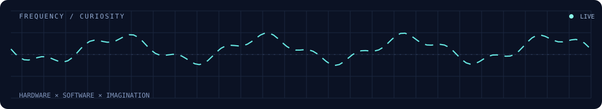

<div align="center">



<br />

<sub>✦ <b>BUILDING AT THE INTERSECTION OF ELECTRONICS, CODE &amp; CURIOSITY</b> ✦</sub>

<br /><br />

<a href="#the-person-behind-the-signal">ABOUT</a> &nbsp;·&nbsp; <a href="#currently-exploring">EXPLORING</a> &nbsp;·&nbsp; <a href="#my-toolbox">TOOLBOX</a> &nbsp;·&nbsp; <a href="#the-next-missions">MISSIONS</a>

</div>

---

### `// the person behind the signal`

I'm **Utkarsh**, an **Electronics & Communication Engineering** student in India, interested in how things work — from circuits and communication systems to the code that makes technology feel like magic.

Outside engineering, you'll probably find me thinking about **distant galaxies**, working on a space story for **StarryInsight**, editing a video, photographing something interesting, or planning the next adventure.

> *Dreaming of distant horizons, driven by curiosity.*

```yaml
identity: Utkarsh Kumar
studying: Electronics & Communication Engineering
interests:
  - Embedded systems & electronics
  - Coding and creative technology
  - Space, astronomy & storytelling
  - Networking and security fundamentals
side_quest: Turning cosmic curiosity into things people can experience
status: Learning in public, one project at a time
```

### `// currently exploring`

<table>
<tr>
<td width="50%" valign="top">

**01 / MAKE IT WORK**  
Circuits · electronics · communication systems · embedded ideas

</td>
<td width="50%" valign="top">

**02 / MAKE IT SMART**  
Python · programming fundamentals · automation · practical projects

</td>
</tr>
<tr>
<td width="50%" valign="top">

**03 / MAKE IT MEAN SOMETHING**  
Astronomy · space education · filmmaking · visual storytelling

</td>
<td width="50%" valign="top">

**04 / KEEP EXPLORING**  
Networks · security basics · new tools · unfamiliar rabbit holes

</td>
</tr>
</table>

### `// my toolbox`

<div align="center">


<sub>Learning / using — not claiming expertise in everything shown.</sub>

</div>

### `// telemetry from the curiosity lab`



<div align="center">

<!-- This is intentionally minimal: no fake streaks, inflated skill bars, or empty project cards. -->


</div>

### `// the next missions`

- [ ] Build and document a small electronics + code project
- [ ] Explore an embedded/IoT prototype
- [ ] Publish a Python project that solves a real problem
- [ ] Make a creative experiment inspired by space

<sub>These are goals, not completed projects. Watch this space.</sub>

---

<div align="center">

**SOMEWHERE BETWEEN CIRCUITS AND CONSTELLATIONS.**

*Stay curious. Keep building. Explore farther.*

<a href="https://github.com/utkarshkumar14305-cloud">GITHUB</a> &nbsp;·&nbsp; <a href="https://github.com/utkarshkumar14305-cloud?tab=repositories">PROJECTS</a>

<sub>✧ End of transmission — for now. ✧</sub>

</div>
